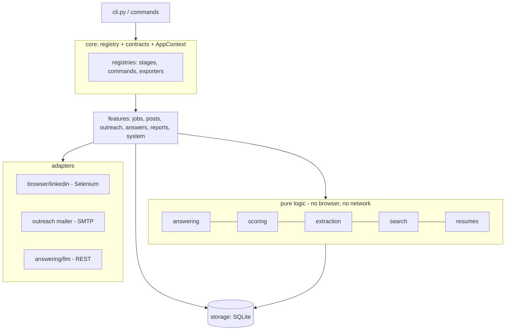

# Architecture

## Goals
Scalable (new job boards/features are additive), maintainable (one place per concern), safe (dry-run, review queue, rate limits), observable (every decision stored and exportable).

## Layers and dependency direction



**Rule:** arrows only point down. `answering`, `scoring`, `extraction` never import Selenium; `browser/` never decides business logic. That is why 77 tests run in under a second with no browser.

## The module system (how it stays extensible)

* `core/registry.py`: generic `Registry`. Three instances: `stages`, `commands`, `exporters`.
* A **Stage** (`name`, `description`, `run(ctx) -> StageResult`) is one unit of the daily run. `settings.pipeline.stages` decides which run and in what order.
* A **Command** adds a CLI sub-command. `cli.py` is never edited to add one.
* `core/plugins.py` loads built-in `features.*` modules, modules listed in `settings.plugins`, and pip entry points (`jobpilot.plugins`). A broken plugin is logged and skipped.
* **Ports** (`features/jobs/ports.py`): `JobSource`, `Applier`. The pipeline depends on these Protocols, so a new job board only implements them.

## Data flow (one `jobpilot run`)

```
posts stage   : LinkedIn post search -> analyze_post -> posts + contacts tables
jobs stage    : QueryPlanner -> JobSource -> harvest contacts -> JobScorer -> choose_resume
                -> Applier(EasyApplier) -> AnswerEngine per form field -> jobs table
outreach stage: contacts -> relevance filter -> drafts (mail_queue) -> [approve] -> SMTP
run           : export Excel + report
```

## Answer engine (the "intelligence")

`user bank > canned (profile.yaml) > rules > cached LLM > LLM > review queue`

* Rules are small registered functions deriving answers from the profile (CTC in lakhs/monthly, notice period, years per skill, eligibility...). Guards prevent keyword leaks (`state` inside a long sentence).
* The LLM, if enabled, may use ONLY profile facts, must return JSON `{answer, confidence}`, and its answer is validated against the field type/options before use.
* Anything unanswered is stored `pending`; answer it once (`answers set` / UI) and it becomes a permanent `user` answer. Every question seen is logged with a counter.

## Key decisions (and why)

| Decision | Reason |
|---|---|
| SQLite instead of CSV | atomic writes, dedupe via constraints, queries, still exportable |
| URL-built searches (`f_AL`, `f_TPR`, `sortBy=DD`) | one page load instead of ~25 fragile filter clicks; freshest first |
| Single LinkedIn session | parallel sessions on one account are the fastest route to a flag. Parallelism is used where safe: LLM calls, extraction, mail |
| Dry-run default | safe to experiment; same code path as live up to the submit click |
| No random answers | a wrong answer silently damages an application; a queued question is fixed once |
| Selectors in one file | LinkedIn markup changes; fixes become 5-minute edits |
| Settings reject unknown keys | typos fail at startup, not mid-run |
| Versioned DB migrations | upgrade the schema without losing history |

## Data model (SQLite)

`jobs`, `questions`, `posts`, `contacts` (UNIQUE kind+value), `mail_queue` (UNIQUE to_email), `search_stats`, `runs`. Migrations are append-only in `storage/db.py`.
